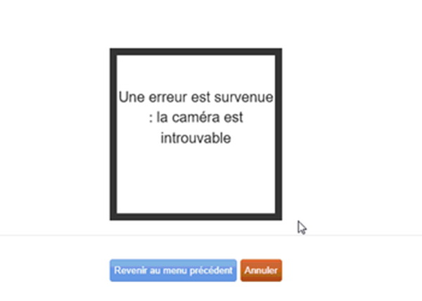
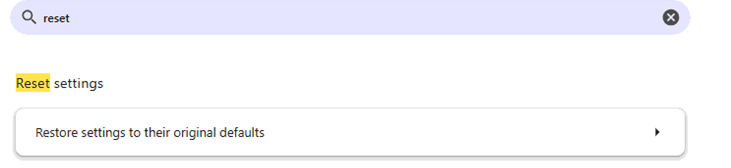
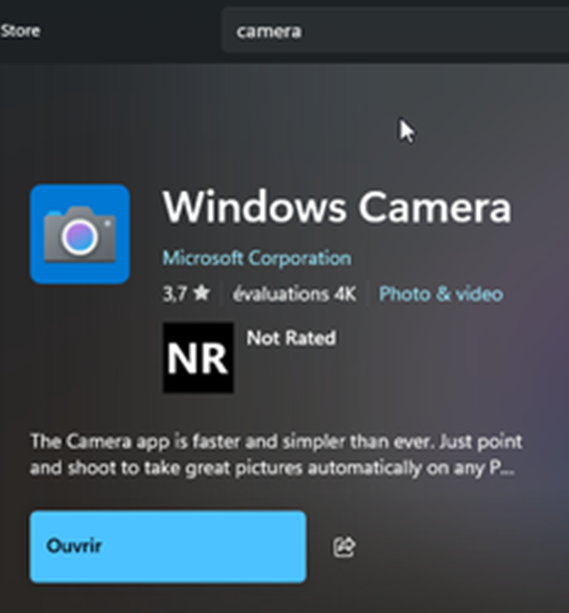

# CAMERA

# LogiFitness - Probleme de Camera

Il arrive que la configuration de la CAMERA soit perdu ou defectueuse et que dans LogiFitness ca n’apparaisent plus. Veuillez suivre les operations ci-dessous avant d’ouvrir une demande de support.

Premierement, il faut s’assurer que la camera soit plugger (DIRECTEMENT) dans le PC.

Suivre le cable et le debrancher et rebrancher dans le PC.

To reset Google Chrome settings to their default, you can: 

1.      Open Chrome on your computer

2.      Select More in the top right corner

3.      Select Settings

4.      Select Advanced at the bottom

5.      Under the "Reset" section, click Reset

6.      Click Restore settings to their original defaults

7.      Click Reset settings in the pop-up window

To reset the settings in Microsoft Edge to their default values, you can do the following: 

1.      Open Microsoft Edge

2.      Click the three dots in the top right corner

3.      Select Settings

4.      Click the Reset Settings tab in the left sidebar

5.      Select Restore settings to their default values

6.      Click Reset

Ouvrir l’application Windows Camera, si elle n’est pas presente l’installer a partir de Microsoft Store:

Si ca ne fonctionne pas:

Debrancher la camera, et l’ essayer dans un autre appareil, PC, portable etc.

Achat nouvelle camera:

Modele Recommander:

[https://www.amazon.ca/NexiGo-StreamCam-N930E-Auto-Focus-Learning/dp/B08J896MYT/ref=sr\_1\_5?crid=35DJJ3R85SMOY&dib=eyJ2IjoiMSJ9.MqvEu5syfDwt13JyZWP8LdeG3cBVAJm9IDPjg5B9L1VRSSLXkCIrpqUkVh6i9zdpxxAAqWH2tEZ6hQkhYMjGtI4VrnV3XOJTeajlku7Bu5fZlOG02rJ0z\_46ilk51UCsaZ1gikZvnBvntt03\_ZoFkYBhmayBHPMmM7HFkKZQsiTGMeDShn\_EiXMj\_\_NnprHT3Bj4QvVBs\_k7lm4NhlyIZ730PRl16q3Ak2URR79uzfjg\_X8p0tYKVNBpobBPaKoBjDcVTWxHTSdSAPsKG39sZY9FNRHsgHn-j1aTxFLVsJqvuCtmyrVRkStjFp8w\_SMKhUQssXSTI1Z7uIN5jRZ1eJhSGdvTLmCd8Q5OG7Ia0FKnGPtbrzbkKhIk8r6EXvjZQTu2bieojlcwxURebkuaM5cUWNVt6GirKjAC9eEh0J2aku24CMNiGLOzAbx-SkZw.W0JQ5WLk\_nINVhIbiMmgWgA\_6Pqbr--lKjI8kawvXe4&dib\_tag=se&keywords=nexigo%2Bcamera%2Bstreamcam&qid=1736179557&sprefix=nexigo%2Bcamera%2Bstreamcam%2Caps%2C70&sr=8-5&th=1](https://www.amazon.ca/NexiGo-StreamCam-N930E-Auto-Focus-Learning/dp/B08J896MYT/ref=sr_1_5?crid=35DJJ3R85SMOY&dib=eyJ2IjoiMSJ9.MqvEu5syfDwt13JyZWP8LdeG3cBVAJm9IDPjg5B9L1VRSSLXkCIrpqUkVh6i9zdpxxAAqWH2tEZ6hQkhYMjGtI4VrnV3XOJTeajlku7Bu5fZlOG02rJ0z_46ilk51UCsaZ1gikZvnBvntt03_ZoFkYBhmayBHPMmM7HFkKZQsiTGMeDShn_EiXMj__NnprHT3Bj4QvVBs_k7lm4NhlyIZ730PRl16q3Ak2URR79uzfjg_X8p0tYKVNBpobBPaKoBjDcVTWxHTSdSAPsKG39sZY9FNRHsgHn-j1aTxFLVsJqvuCtmyrVRkStjFp8w_SMKhUQssXSTI1Z7uIN5jRZ1eJhSGdvTLmCd8Q5OG7Ia0FKnGPtbrzbkKhIk8r6EXvjZQTu2bieojlcwxURebkuaM5cUWNVt6GirKjAC9eEh0J2aku24CMNiGLOzAbx-SkZw.W0JQ5WLk_nINVhIbiMmgWgA_6Pqbr--lKjI8kawvXe4&dib_tag=se&keywords=nexigo%2Bcamera%2Bstreamcam&qid=1736179557&sprefix=nexigo%2Bcamera%2Bstreamcam%2Caps%2C70&sr=8-5&th=1)
