# GoogleTV

# Configure GoogleTV and AbleSign

Time required: 25 minutes

# INITIAL SETUP

1.      Enter the WIFI password for FITCORP

1.      Wait for the updates completed

2.      Sign in to the TV using account@email

1.      Wait for the updates to be completed

## Enable Developper Mode

1.      Go to Settings

2.      Select System -> About -> in the Device row

3.      Scroll down and click Build multiple times until a dialog appears

4.      Go back

1.      Select Developer options in the Preferences row

2.      Select USB debugging

3.      Select On

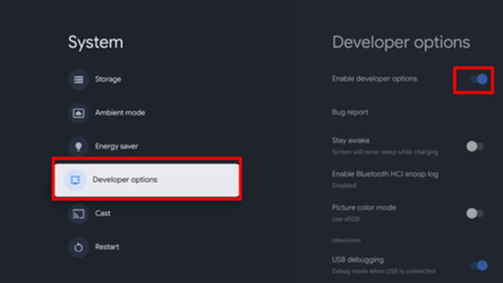

# 1. ADD NEW GOOGLETV TO THE TV MANAGER CONSOLE

Open the Google TV Manager URL :[http://192.168.20.6](http://192.168.20.6)

Add the DEVICE with the proper IP from the WIFI information page.

Initiate Connect to add the Developper Certificate. 

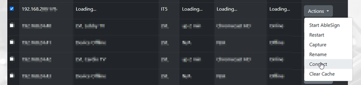

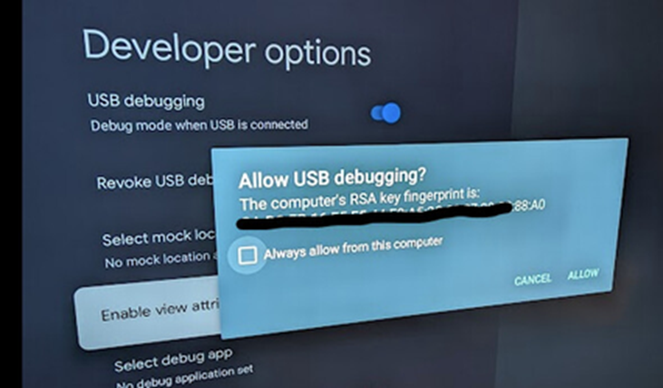

# Install AbleSign App on the Google TV

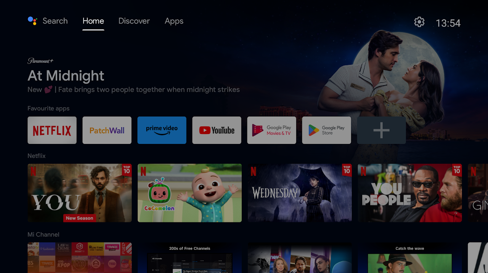

 Now use the down arrow on your remote to select Open the Google Play store.

On the Play Store page, select search from the top menu.

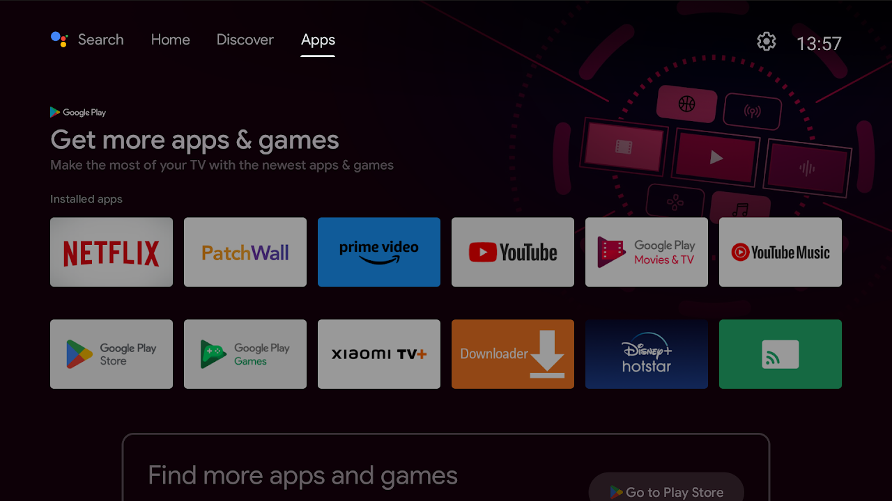

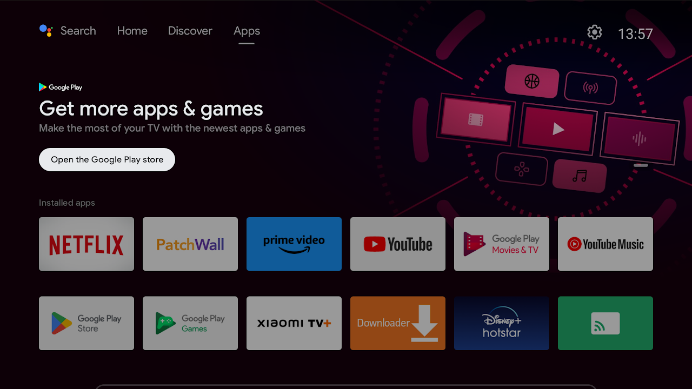

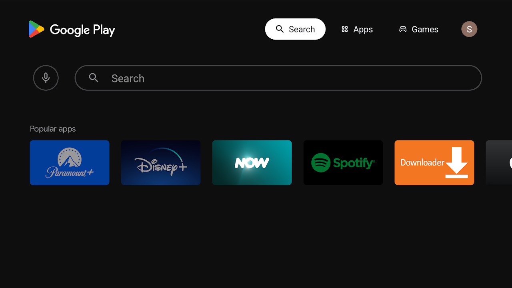

Click in to the search field and type ablesign (all one word).

Select AbleSign from the search results.

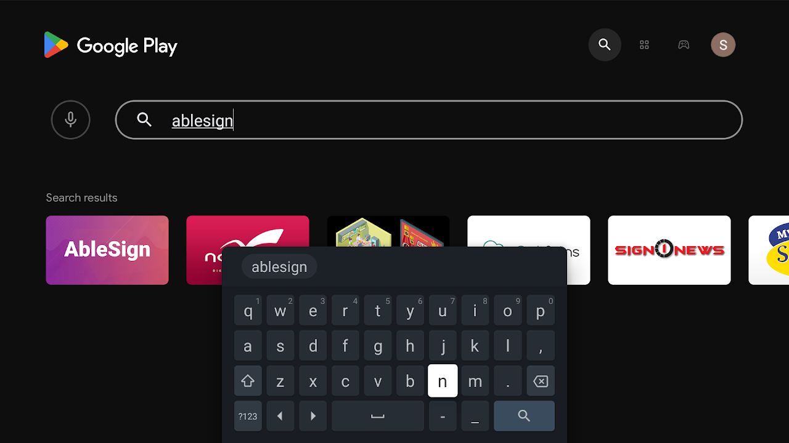

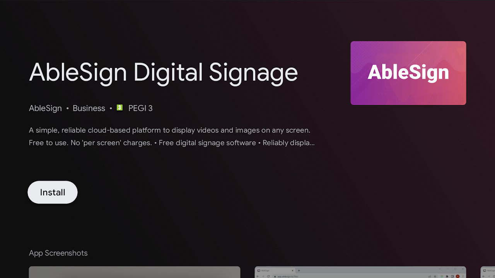

Click Install and the app will be installed. Finally, click Open to open the app.

Open Able Sign

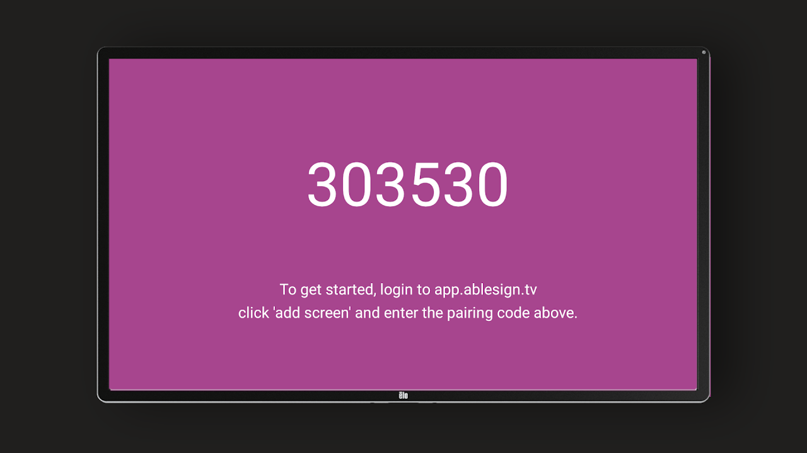

 Press the UP BUTTON on the screen using your REMOTE.  
 Press the menu or up key on your remote control to bring up the Player Options menu. 

Press select to enable the option.

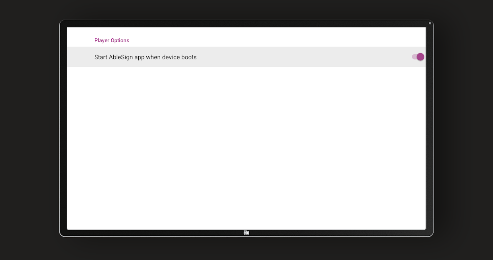

# Configure the GOOGLE TV Settings

 Go to SYSTEMS with the GEAR.

DISPLAY & SOUND - DISABLE HDMI-CEC

  

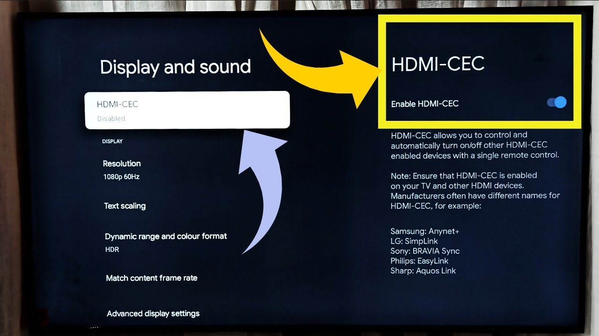

Account & sign-in

Select the account sign@it5.app  
 and SET APPS ONLY MODE

  

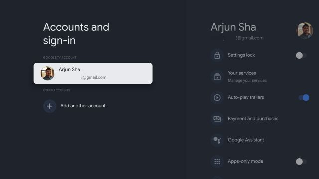

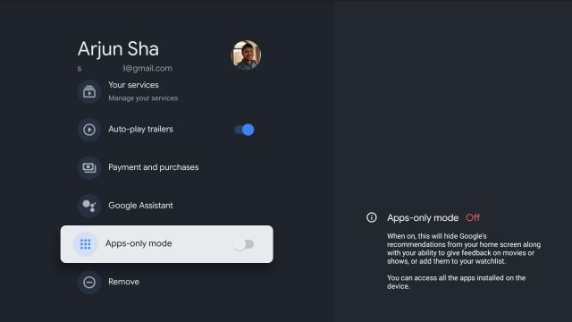

 APPS

Select Able SIGN to auto-start at reboot  

 Select Special app access.

Select Display over other apps.

From the list, make sure that AbleSign is turned on.

AbleSign will automatically start when your device boots

  

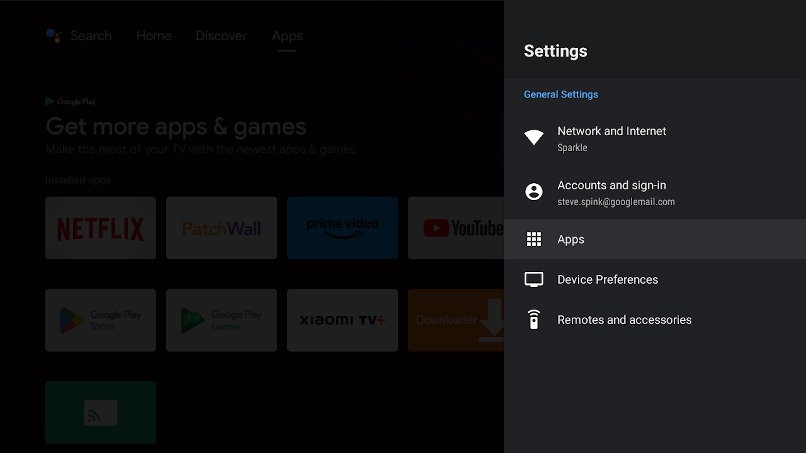

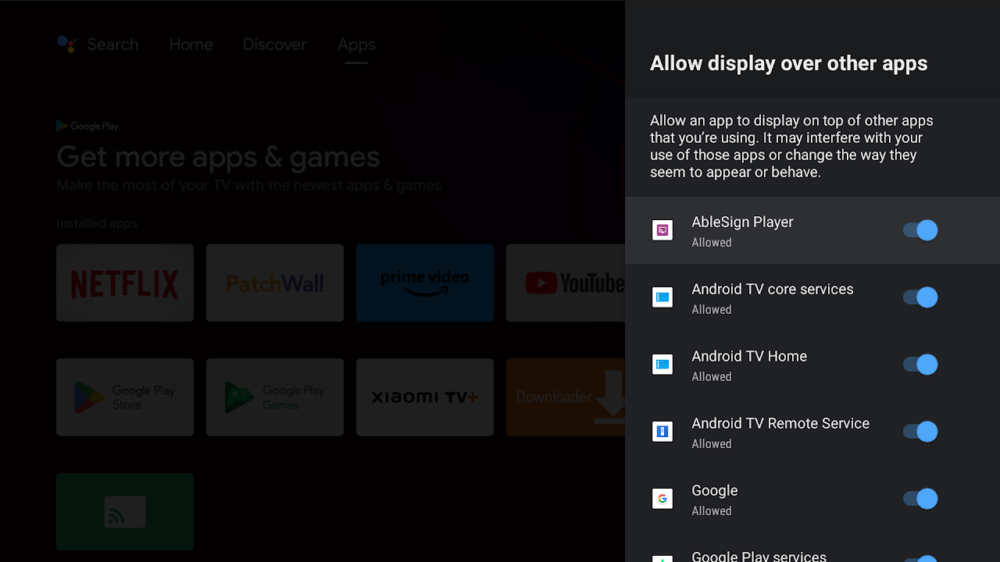

# Configure the GOOGLE TV SYSTEM Settings

GO TO ABOUT -

Assign a Device NAME : Example (FIT-RDP-01)  
 FIT-SITE-ID

  

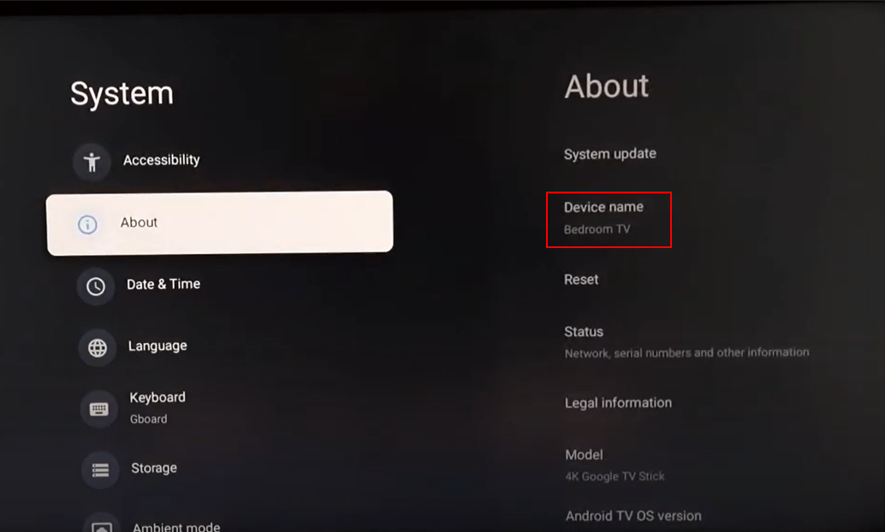

Power & Energy  
Set inactive to NEVER

  

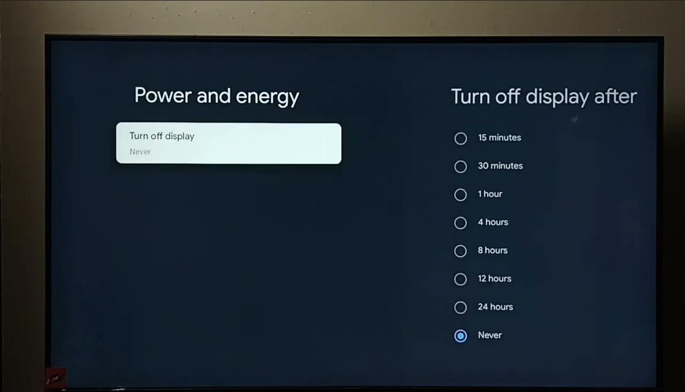

Set CAST to Never

  

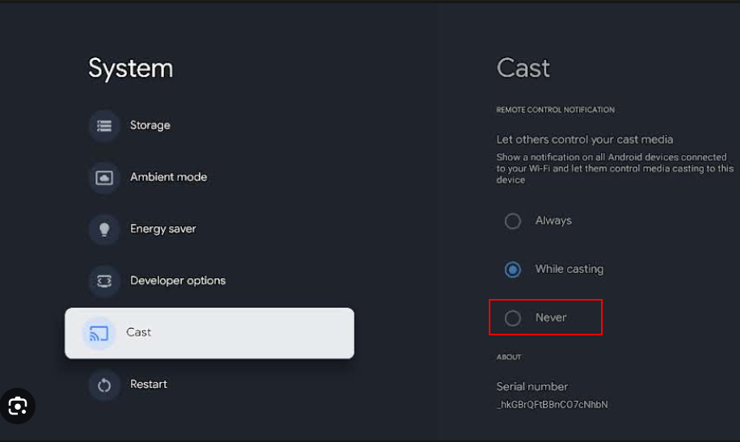

Set Network Device Scan (DISABLE)

  

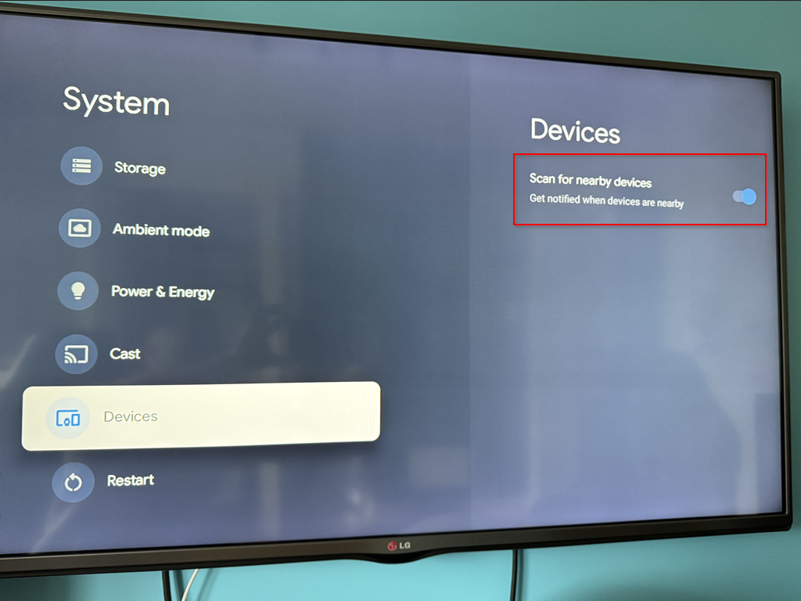

# Add chromecast to the ABLESIGN portal

# Login to AbleSign

If you are new to AbleSign then please create a free account at [app.ablesign.tv](https://app.ablesign.tv/).

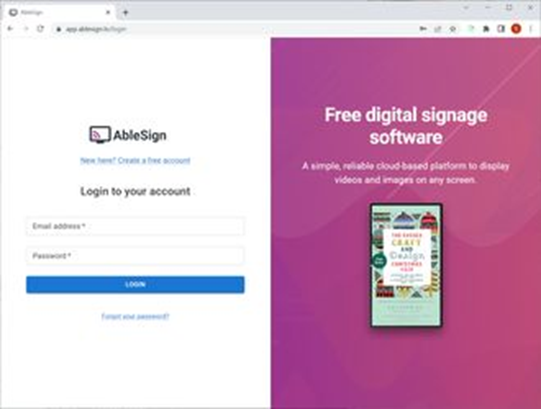

Click on SCREENS in the top menu bar to take you to the screens page, then click the ADD SCREEN button.

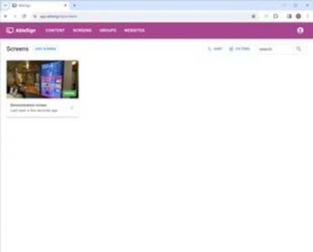

A window will appear asking for the pairing code of your new screen.

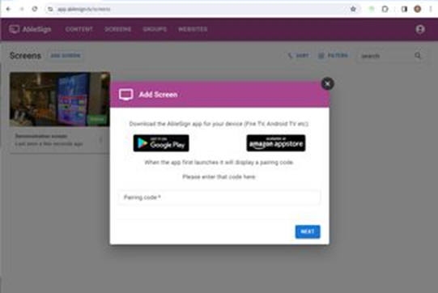

# RESTART google tv et validate that it, boots to able sign

Key Notes

• Some devices, particularly those from manufacturers with strict security policies (e.g., Samsung, Google), may clear authorizations as a security feature.

• If persistent USB debugging is critical, consider using devices with less restrictive ROMs or configurations.
