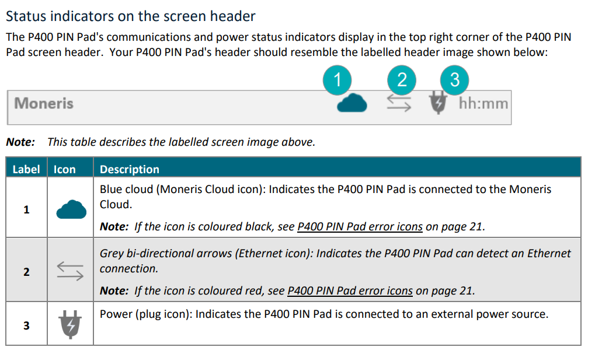
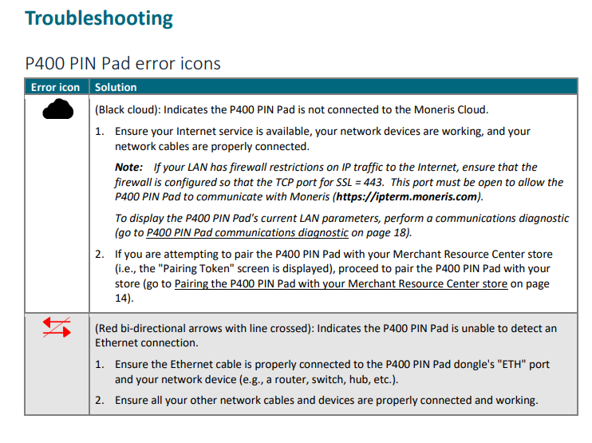
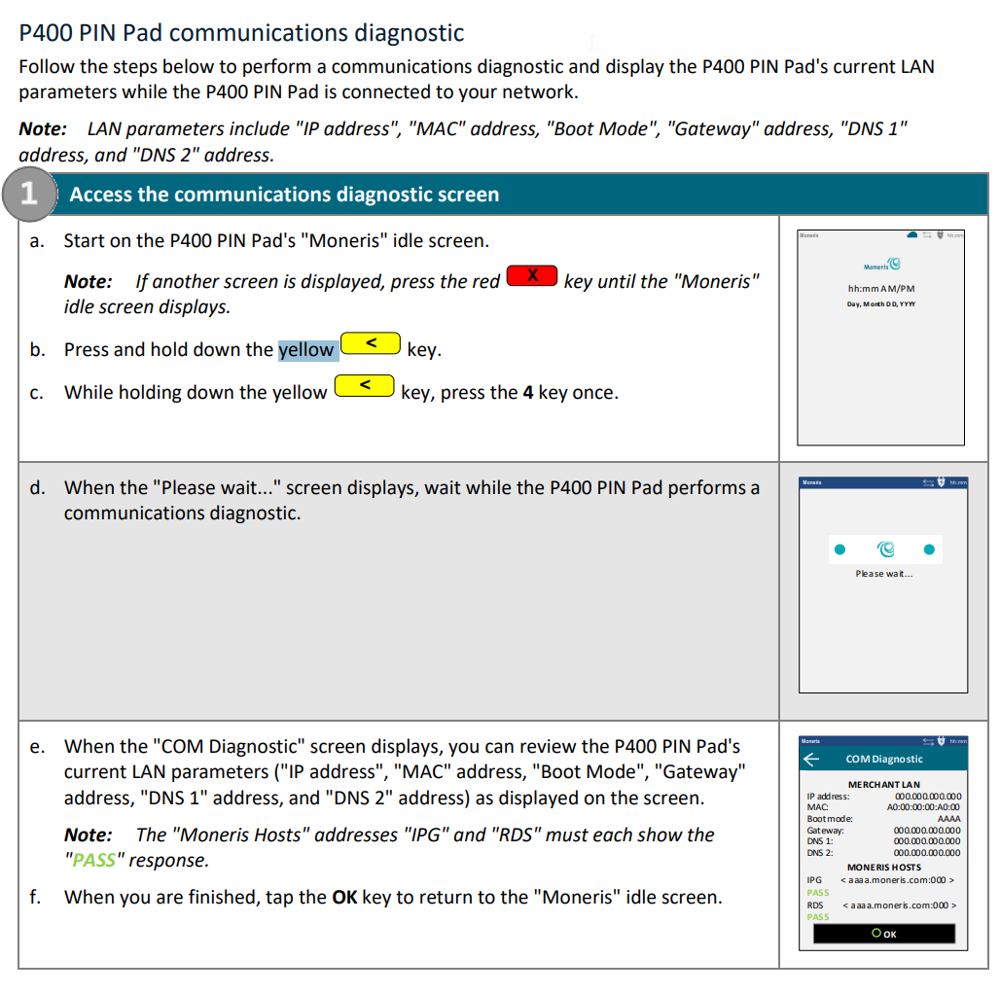
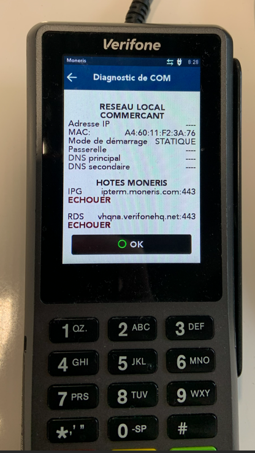

# MONERIS

MONERIS NETWORK ISSUE

  

Status Indicator

NETWORK STATUS

IF there is a Black Cloud or RED LINES, its a network issue.

NETWORK DIAGNOSTIC  

Documentation:

## Diagnostic

FAILED NETWORK EXAMPLE:  

## Diagnostic

DOCUMENTATION

[https://www.moneris.com/-/media/files/downloadable\_guides/p400\_mrc\_qig-eng.ashx](https://www.moneris.com/-/media/files/downloadable_guides/p400_mrc_qig-eng.ashx)Call Moneris Customer Care (available 24/7) toll-free at 1-866-319-7450, or email

onlinepayments@moneris.com. We’ll be happy to help
