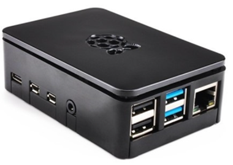
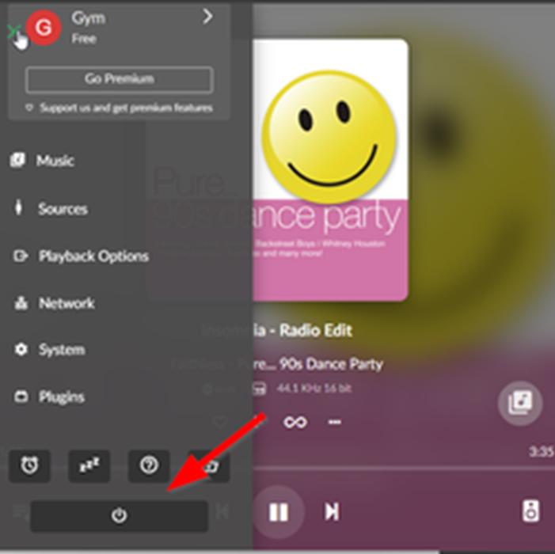
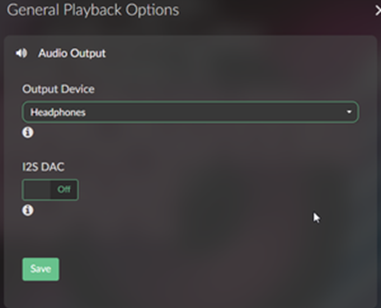
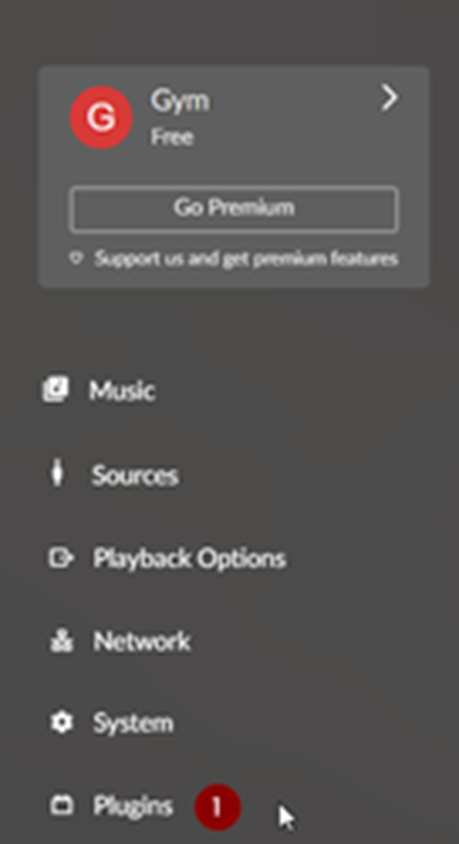
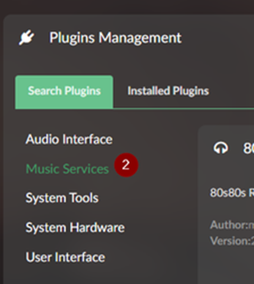
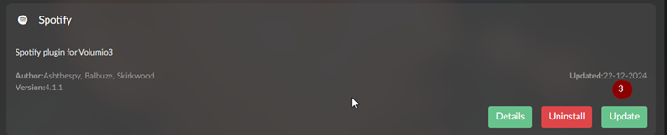
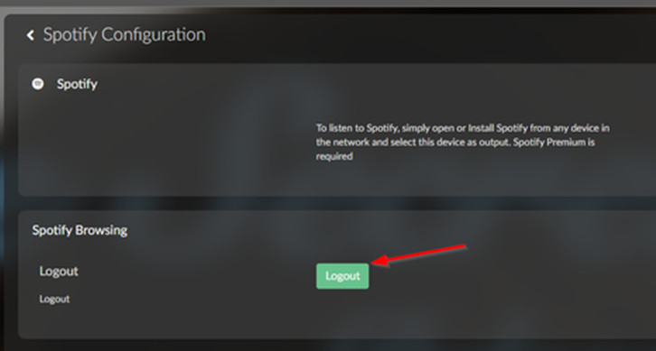
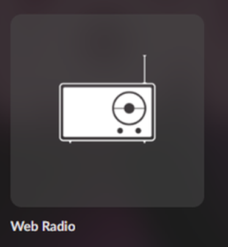

# VOLUMIO

# Musique et Volumio

Start by Rebooting VOLUMIO

Click the POWER Button and restart Volumio

OR

Restart Volumio by Unplugging the USB-C

- 

I SEE THE MUSIC PLAYING BUT THERE IS NO SOUND

Validate the Volume and the OUTPUT

Validate the Output Device → to HEADPHONES

UPDATE THE PLUGINS TO THE LATEST VERSION

Update the current SPOTIFY pluggins.

DO NOT INSTALL ANY OTHER PLUGINS

AFTER INSTALLATION → REBOOT

- Update the Plugins Spotify Credentials

RECONNECT THE SPOTIFY PLUGINS

\*\* For Administration only

In the Plugins (Logoff)

Then with your browser login again using the proper account in spotify.

\*\*Account cannot be shared between the center, it must be the one assign to your location

USE WEB RADIO

Select some Music from Web Radio or MP3.  

WARNING:

Spotify, Youtube Music, and all online streaming services are often changing their policy and code breaking the services. This is not supported as Volumio is a free systems. until VOLUMIO fix the issue, the only option is to use local music.  

Open a SUPPORT TICKET for further troubleshooting if not related to the above.

