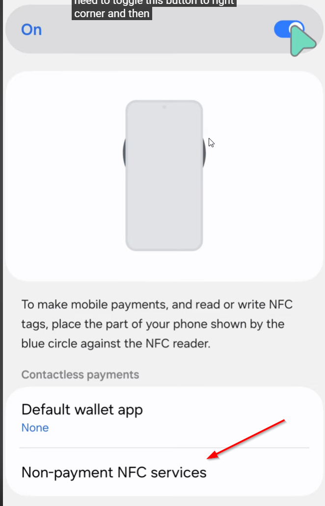

# NFC / RFID — Diagnostic des passes d’accès

## Objectif et types de passes RF

Ce guide aide à déterminer pourquoi une passe RF ne permet pas l’entrée : problème de passe, de portefeuille mobile, de lecteur, de contrôle d’accès ou de tourniquet.

Les passes utilisées comprennent :

- **Jeton physique SLIX (keytag)** : porte-clés RFID présenté directement au lecteur, sans téléphone ni application Wallet.
- **Passe mobile sur iPhone** : carte d’accès PassKit enregistrée dans **Cartes (Apple Wallet)**.
- **Passe mobile sur Android, dont Samsung Galaxy** : carte d’accès PassKit enregistrée dans **Google Wallet**.

## 1. Observer ce qui se passe au lecteur et au tourniquet

Présenter une seule passe au lecteur et la maintenir en place jusqu’au résultat. Relever les réactions du lecteur, le résultat dans LogiFitness ou l’interface de contrôle d’accès, et le comportement du tourniquet.

| Observation | Orientation du diagnostic |
| --- | --- |
| Aucune réaction ni événement visible | Faire les essais comparatifs ci-dessous pour départager la passe et la chaîne de lecture. |
| Bip ou voyant seulement, sans résultat d’accès confirmé | Relever la réaction et rechercher le résultat dans le système. Un bip ou un voyant seul ne confirme pas une autorisation. |
| Passe ou client reconnu, mais accès refusé | Faire vérifier l’association de la passe au client et ses droits d’accès selon le message de refus. |
| Accès confirmé comme autorisé, mais tourniquet bloqué | Orienter le diagnostic vers la commande d’ouverture et le tourniquet. |

**La présence du client dans LogiFitness ne suffit pas à confirmer que l’accès est autorisé.** Relever le résultat de l’accès avant de conclure que le tourniquet est défectueux.

## 2. Comparer avec une passe qui fonctionne

Utiliser une passe de test autorisée, connue pour fonctionner sur ce lecteur. Comparer, si possible, une passe du même type que celle en échec, puis un jeton SLIX et une passe mobile.

1. Tester la passe en problème sur le lecteur concerné.
2. Tester la passe connue comme fonctionnelle sur ce même lecteur.
3. Si un autre lecteur compatible est disponible, y tester la passe en problème et la passe de référence.
4. Noter pour chaque essai : absence de lecture, refus d’accès, autorisation et ouverture réelle du tourniquet.

| Résultat des essais | Suite du diagnostic |
| --- | --- |
| Une seule passe échoue; une autre du même type fonctionne sur ce lecteur | Vérifier la passe concernée, son association au client et, pour un mobile, son Wallet. Une panne générale du tourniquet est moins probable. |
| Le jeton SLIX fonctionne, mais une passe mobile échoue | Suivre les vérifications du téléphone et du Wallet. Le succès du jeton ne valide pas toute la lecture mobile. |
| Les passes mobiles fonctionnent, mais un jeton SLIX échoue | Suivre les vérifications du jeton physique. Le succès des mobiles ne valide pas toute la lecture des jetons. |
| Plusieurs passes fonctionnent sur un autre lecteur compatible, mais échouent sur celui-ci | Faire vérifier le lecteur concerné, sa configuration et la chaîne de contrôle d’accès. |
| Plusieurs passes, physiques et mobiles, ne sont pas détectées sur ce lecteur | Faire vérifier le lecteur, son alimentation, sa liaison au contrôleur et les services de contrôle d’accès. Ce résultat ne prouve pas une panne mécanique du tourniquet. |
| L’accès est autorisé, mais le tourniquet ne se déverrouille pas | Suivre la section de diagnostic du tourniquet ci-dessous. |

Ces essais orientent le diagnostic; ils ne prouvent pas à eux seuls qu’un jeton, un lecteur ou un tourniquet est défectueux.

## 3. Jeton physique SLIX / keytag — La passe RF ne fonctionne pas

1. Présenter le jeton SLIX seul devant le lecteur, séparé des autres cartes ou jetons, et le maintenir en place jusqu’au résultat.
2. Comparer avec un autre jeton SLIX connu pour fonctionner sur ce lecteur.
3. **Jeton détecté, accès refusé** : faire vérifier que ce jeton est associé au bon client et que ses droits d’accès sont valides.
4. **Jeton non détecté, alors qu’un autre SLIX fonctionne** : essayer le jeton concerné sur un autre lecteur compatible, si disponible, puis transmettre les résultats au support. Le jeton peut être en cause; le remplacement reste à confirmer.
5. **Plusieurs jetons SLIX non détectés** : poursuivre le diagnostic du lecteur et du contrôle d’accès avec les essais comparatifs.

Les réglages Apple Wallet, Google Wallet et Samsung Wallet concernent les passes mobiles et ne s’appliquent pas au jeton physique SLIX.

## 4. iPhone — La passe mobile ne se lit pas en NFC

1. Ouvrir **Cartes (Apple Wallet)** et vérifier que la carte d’accès du centre est présente.
2. Si elle est absente, utiliser le lien d’ajout de carte fourni par le centre et terminer l’ajout à Apple Wallet avant de réessayer.
3. Sélectionner la carte d’accès dans Apple Wallet. Effectuer l’authentification si elle est demandée.
4. Approcher le **haut de l’iPhone** du lecteur NFC et le maintenir en place jusqu’à la confirmation de lecture. Éviter de retirer le téléphone trop vite.

Apple décrit la sélection d’un pass et la présentation du haut de l’iPhone au lecteur dans son [guide d’utilisation des cartes et pass dans Wallet](https://support.apple.com/en-gb/guide/iphone/iphe7aa3336/ios).

## 5. Android — La passe mobile ne se lit pas en NFC

1. Vérifier que le téléphone possède la fonction **NFC** et qu’elle est activée. Rechercher « NFC » dans les paramètres du téléphone; les menus varient selon le fabricant.
2. Ouvrir **Google Wallet** et vérifier que la carte d’accès du centre est présente. Si elle est absente, utiliser le lien d’ajout fourni par le centre pour l’ajouter à Google Wallet.
3. Déverrouiller le téléphone et ouvrir Google Wallet pour faire l’essai.
4. Présenter la zone de l’antenne NFC du téléphone au lecteur et maintenir le téléphone en place jusqu’à la confirmation de lecture. L’emplacement de l’antenne dépend du modèle.
5. Sur un **Samsung Galaxy**, vérifier aussi le réglage des services NFC hors paiement décrit dans la section suivante.

Google décrit l’utilisation de Google Wallet ou du téléphone déverrouillé pour la lecture des pass dans le [fonctionnement de Smart Tap](https://developers.google.com/wallet/smart-tap/introduction/communication-flow). Le pass et le lecteur doivent être compatibles avec cette fonction.

## 6. Samsung Galaxy — Google Wallet et services NFC hors paiement

**Symptôme ciblé :** la carte d’accès est présente dans Google Wallet et le NFC est activé, mais la carte n’est pas lue au lecteur. Si Samsung Wallet s’ouvre à la place du portefeuille attendu, vérifier également ce réglage.

La procédure locale utilise **Google Wallet pour la carte d’accès PassKit sur Samsung**. Le réglage à vérifier est celui des **services NFC hors paiement**.

1. Ouvrir **Paramètres (Settings)**.
2. Aller dans **Connexions (Connections)**.
3. Ouvrir **NFC et paiements sans contact (NFC and contactless payments)** et vérifier que le NFC est activé.
4. Ouvrir **Services NFC hors paiement (Non-payment NFC services)**. Selon la version de One UI, cette option peut se trouver directement sur cet écran ou dans **Paiements sans contact (Contactless payments)**.
5. **Activer ou sélectionner Google Wallet** dans les services NFC hors paiement.
6. Revenir dans Google Wallet, vérifier la présence de la carte d’accès, puis refaire un essai au lecteur avec le téléphone déverrouillé.

**Le choix du portefeuille de paiement par défaut et les services NFC hors paiement sont des réglages distincts.** Pour cette procédure d’accès, vérifier Google Wallet dans **Non-payment NFC services**; changer uniquement l’application de paiement par défaut ne vérifie pas ce réglage.

La capture de la procédure locale montre l’option **Non-payment NFC services**, sous le choix du portefeuille par défaut :

## 7. Téléphone toujours sans réaction après les vérifications

1. Sur Android, désactiver puis réactiver le NFC et refaire un essai.
2. Retirer temporairement la coque ou le porte-cartes du téléphone et refaire un essai, surtout s’il contient des cartes ou des éléments magnétiques.
3. Vérifier la position de l’antenne NFC du modèle. Sur Samsung, l’écran **NFC et paiements sans contact** peut afficher un schéma de positionnement.

Ces vérifications de coque, d’antenne et de réactivation du NFC sont décrites dans le [guide de dépannage NFC de Samsung](https://www.samsung.com/sg/support/mobile-devices/troubleshoot-nfc-issues-on-galaxy-devices/).

## 8. Accès autorisé, mais tourniquet bloqué

Après avoir confirmé que le système autorise l’accès, observer si la commande d’ouverture produit le clic habituel du relais et si le tourniquet se déverrouille.

- **Autorisation confirmée, clic entendu, tourniquet bloqué** : faire vérifier la liaison électrique et le mécanisme du tourniquet. Le clic ne prouve pas à lui seul une panne mécanique.
- **Autorisation confirmée, aucun clic ni déverrouillage** : faire vérifier la commande d’ouverture, le contrôleur, le relais et leur liaison au tourniquet.
- **Accès refusé ou résultat inconnu** : faire vérifier le résultat dans le système de contrôle d’accès avant de conclure à une panne du tourniquet.

Poursuivre avec la procédure du modèle concerné : [tourniquet ancien](tourniquet.md) ou [tourniquet V2](tourniquet-v2.md). Pour un lecteur de porte, consulter la [procédure Portes](portes.md).

## 9. Informations à transmettre au support

- Centre et porte ou tourniquet concernés, avec date et heure des essais.
- Type de passe en problème : jeton SLIX / keytag, iPhone ou Android / Samsung.
- Pour un mobile : modèle, version d’iOS ou d’Android, Wallet utilisé et présence de la carte d’accès.
- Réaction du lecteur et résultat exact dans LogiFitness ou le contrôle d’accès : aucune lecture visible, refus ou autorisation.
- Résultats comparatifs : autre passe du même type, jeton SLIX, passe mobile et autre lecteur compatible, selon les essais disponibles.
- Après une autorisation : clic de relais entendu ou non, et déverrouillage réel ou non.

Utiliser le [formulaire de demande de support](https://forms.office.com/r/gVDvi4kEbR).
