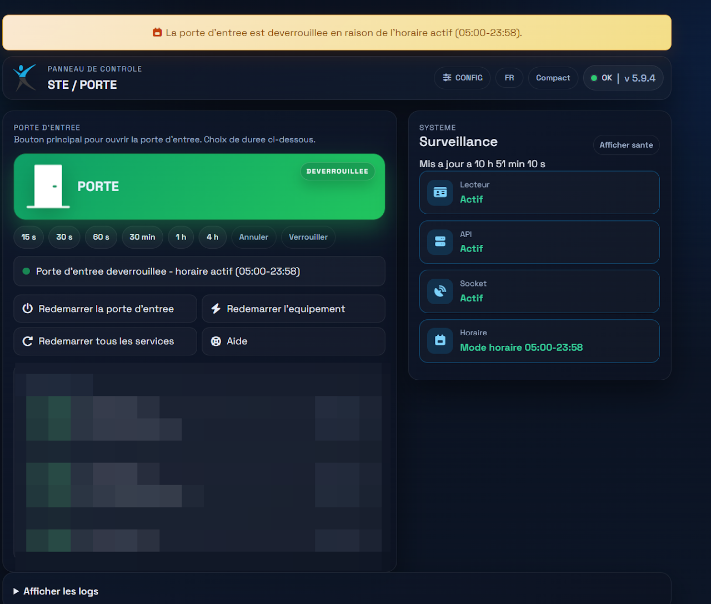
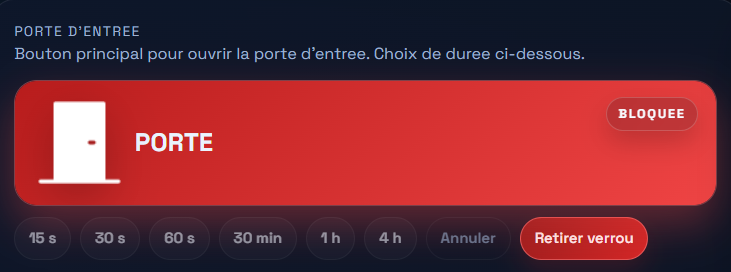
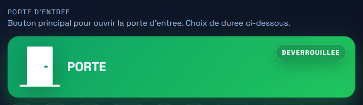
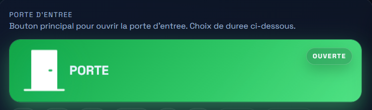
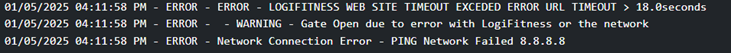

# PORTES

GARDE LA PORTE DEBARRER (Electric Latch)

## VOIR VIDEO:

[Contenu intégré](https://www.youtube.com/embed/3ePxctrGOLk?embed_config=%7B%22enc%22:%22AXH1ezlKkgvmFANU5VLBPnWH-4DnfDqopuZntHTcmwAr80XpOq-WB_HkBe3j0jjouNtySLnd9v3Lo1JYDjXMNfJpFMWIFmvLlOo9VSUHVSQRsf61qv0hCPq9fgiBszsKs3hZAUo_btjUJaXZTX7KkBYTKFr-FIAszliIFJR7OX6gqU41ZG3-DeBLV4sBVgp-3usDk5oyLfXRWAM4KmsegCE_4sofsqNSHqAdacJCCYkcYD13M25FyCiIVGNbnzbd3Z3cIwJGpggcCGKsX6W_BO3mj9O_dH2J1wg9FijlnKaJgS8Nb0GoP9XKMlsZdOcx30q2L0r_Y_ZBRp21mCHU9X71u_mVdiNznL7s2AL87d8d3KUmyS7hZDmnS1EjJscGBkAE%22%7D&enablejsapi=1&errorlinks=1&origin=https://sites.google.com&vl=1)

OUVRIR LA PORTE

Les raisons possibles de ce problème sont les suivantes :

- L'utilisateur n'a pas le pass configuré dans son portefeuille (wallet)

- L'utilisateur retire son téléphone avant la fin de la transaction. (TROP VITE)

- L'utilisateur présente une carte de type 4 (ex. : carte de crédit) que le lecteur n'est pas configuré pour lire.

LA PORTE RESTE DEBARRER

BARRER la PORTE lors (EMPECHER CLIENT ENTRER)

S’assurer que tout les services sont vert:

Redemarrage des services.

Cette etape redemarre les services electronique du tourniquets.

  

Utilisez les boutons (Affichez Access ou Erreurs), pour voir le status:

  

Ce message indique que tout est fonctionnel.

WARNING - ############################# CORE INIT READER PROCESS STARTED ##########################

WARNING - ######### CLOUD AGENT Started ##########

WARNING - ##### CARD READER VTAP100 on /dev/ttyACM0 #######

Notez les messsage avec la mention ERREUR:

