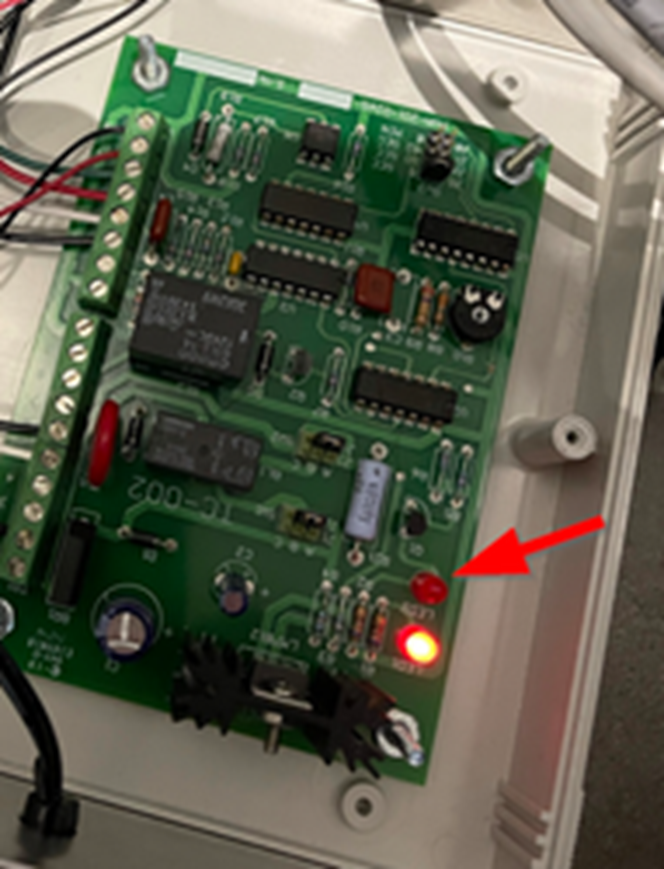
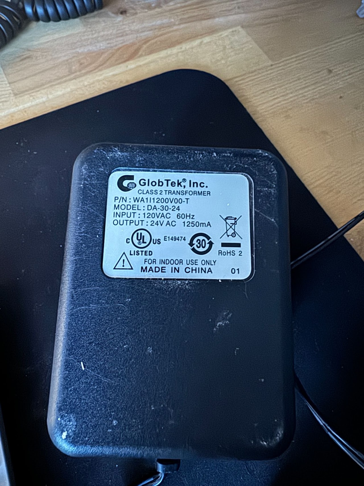

# TOURNIQUET (Ancien)

LE CLIENTS SCAN -> LE CLIENT APPARAIT DANS LOGIFITNESS MAIS CA DEBARRE PAS

Bonne nouvelle ca veut dire que le probleme n’est pas dans le controle d’acces mais directement sur tourniquet.

Il est possible que le probleme soit mecanique ou electrique.

Lorsqu’on SCAN, la boite noire ou blanche produira un TICK sonore, si cest le cas, et ou la lumiere rouge s’allume.

Si ont entend un TICK et la lumiere s’allume le probleme est MECANIQUE dans le tourniquet.

Contactez votre DIRECTEUR

LE CLIENTS SCAN -> MAIS LE CLIENT N'EST PAS DETECTER LORSQU'IL UTILISE un iPhone ou Android (MOBILE)

Les raisons possibles de ce problème sont les suivantes :

- L'utilisateur n'a pas le pass configuré dans son portefeuille (wallet)

- L'utilisateur retire son téléphone avant la fin de la transaction. (TROP VITE)

- L'utilisateur présente une carte de type 4 (ex. : carte de crédit) que le lecteur n'est pas configuré pour lire.

LE TOURNIQUET RESTE DEBARRER

Le tourniquet pourrait etre debrancher, voir si le power supply du tourniquet est bien brancher.

Un lumiere LED rouge sur le controle devrait etre allumer: (voir photo ci-haut)

LE TOURNIQUET NE DEBARRE PAS ET LE CLIENT N'APPARAIT PAS DANS LOGIFITNESS

S’assurer que tout les services sont vert:

Redemarrage des services.

Cette etape redemarre les services electronique du tourniquets.

  
LE TOURNIQUET LAISSE PASSER DEUX PERSONNES ou PLUS

Il est possible que le probleme soit mecanique ou electrique.

1.      Ouvrir le couvert du tourniquet

1.      Ajustement resort et levier.

2.      Switch de detection d’entree mal positionner.

2.      Contactez votre DIRECTEUR
