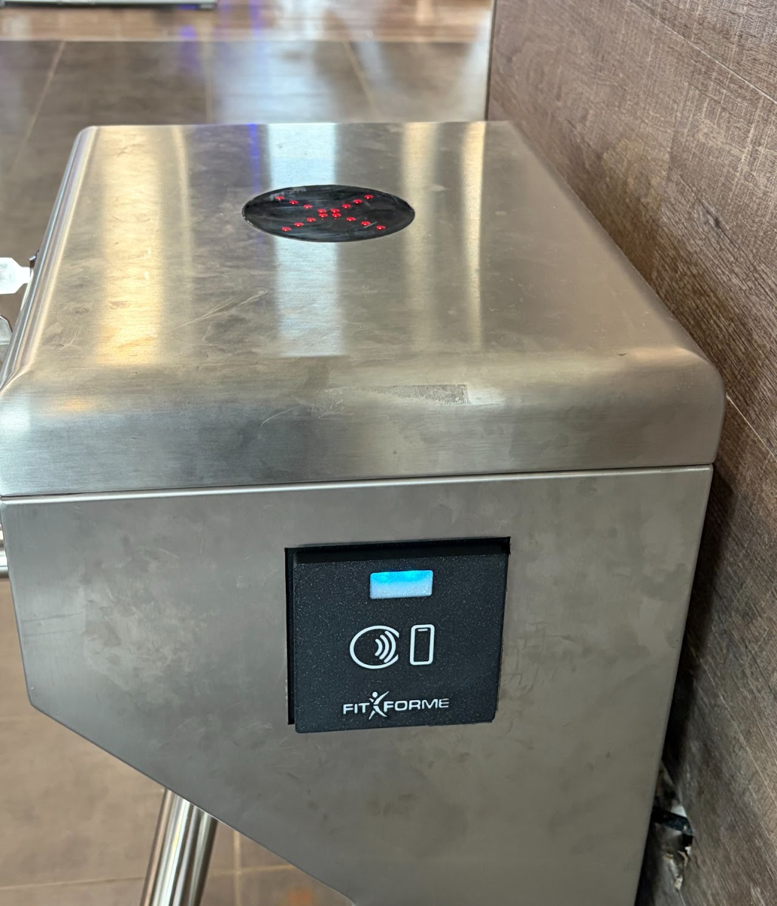
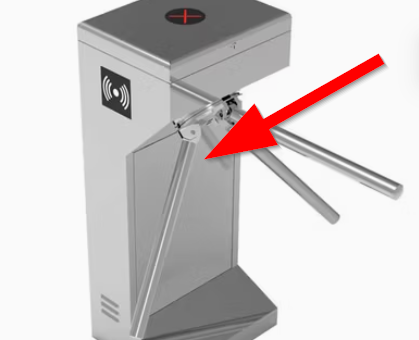
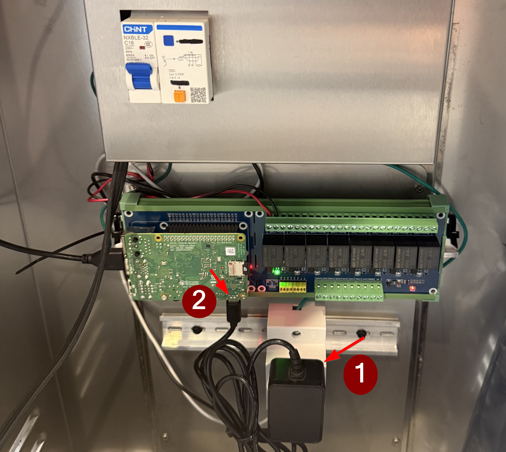
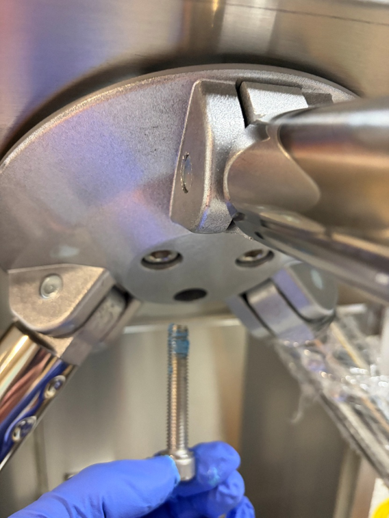

# TOURNIQUET (Nouveau)

Probleme fréquent:  
Sur les modèle V2 tel que montré dans l'image

- ## Page web Non Disponible.

- ## Scan ne fonctionne pas pour les clients.

- ## Le tourniquet reste debarrer.

  

CAUSE: La Vibration peu déconnecté certains cables ainsi que déserrer certaines attaches ou vise.

Voir solution ci-dessous:

# OUVRIR LE TOURNIQUET

Ouvrir le panneau du bas avec la clé fourni.

NE PAS FORCER LA SERRURE, les clées sont unique et vous été fourni avec l'appareil, vous pouvez aussi tester la clé avec le module du HAUT.

# REDEMARRER LE CONTROLLEUR DU TOURNIQUET

Pousser et confirmer que le bloc d’alimentation (1) est bien inséré. Valider que la connexion (2) est bien branchée dans le module de contrôle. 

Une LED verte ou rouge devrait s’allumer à droite.

ASSUREZ-VOUS DE BIEN VERROUILLER LE TOURNIQUET UNE FOIS TERMINÉ.

Note:

Lorsque le tourniquet manque de courrant, les poteaux doivent être descendu au complet et re-initlializer (push down - bring up)

# VIBRATION ET TOURNIQUET LOUSSE

Retirer chaque vise, appliquer une couche de scellant LOCTITE et serrer les vises..

